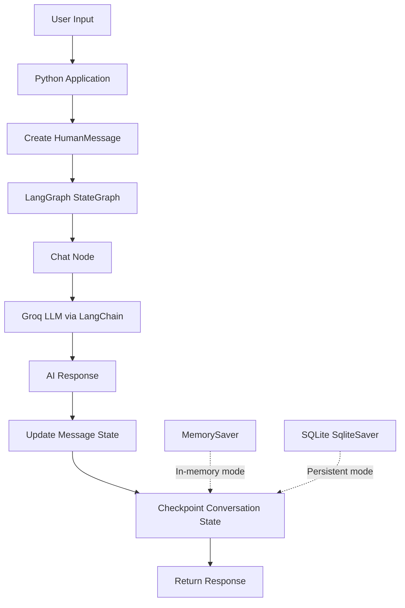

# 🤖 AGENTIC-CHATBOT
### Building Intelligent Conversational AI with LangGraph, LangChain & Groq

**AGENTIC-CHATBOT** is a Python-based conversational AI project that explores how to build stateful AI chatbots using LangGraph, LangChain, and Groq-hosted large language models (LLMs). It demonstrates graph-based conversation workflows, message-state management, and conversation checkpointing, with an SQLite-backed implementation for persistent conversation state.

The project is designed to develop practical skills in **Generative AI, LLM application development, conversational memory, and agentic AI architecture**.

---

## 📌 Table of Contents

- [Overview](#-overview)
- [Key Features](#-key-features)
- [Technology Stack](#-technology-stack)
- [System Architecture](#-system-architecture)
- [Project Structure](#-project-structure)
- [How It Works](#-how-it-works)
- [Getting Started](#-getting-started)
- [Environment Configuration](#-environment-configuration)
- [Running the Project](#-running-the-project)
- [Conversation Memory and Persistence](#-conversation-memory-and-persistence)
- [Example Interaction](#-example-interaction)
- [Error Handling and Troubleshooting](#-error-handling-and-troubleshooting)
- [Security Best Practices](#-security-best-practices)
- [Future Improvements](#-future-improvements)
- [Learning Outcomes](#-learning-outcomes)
- [Author](#-author)
- [License](#-license)

---

## 🚀 Overview

Traditional chatbots often process individual prompts without maintaining a structured conversation state. This project explores a more flexible approach by combining LangGraph's stateful workflow capabilities with LangChain's message abstractions and Groq's LLM inference.

The application uses a graph-based workflow to process user messages and generate AI responses. It also explores checkpointing, allowing conversation state to be associated with a conversation thread.

The project includes two implementation approaches:

1. **Basic conversational chatbot:** Uses LangGraph with in-memory checkpointing through `MemorySaver`.
2. **Database-backed chatbot:** Uses SQLite checkpointing through `SqliteSaver` to persist conversation state across application restarts.

The project provides a foundation for extending a basic LLM chatbot into a more capable AI assistant with tools, retrieval-augmented generation (RAG), and multi-step workflows.

## ✨ Key Features

- **LLM-powered conversations:** Generates natural-language responses using a Groq-hosted language model.
- **Graph-based execution:** Uses LangGraph's `StateGraph` to define and execute a chatbot workflow.
- **Message-state management:** Maintains conversation messages using LangChain message objects and the `add_messages` reducer.
- **Conversation checkpointing:** Saves graph state through a configurable checkpointing mechanism.
- **In-memory conversation state:** Uses `MemorySaver` for temporary checkpoint storage.
- **SQLite-backed persistence:** Uses `SqliteSaver` to store checkpoint data in a local SQLite database.
- **Thread-based conversations:** Uses a `thread_id` to identify and separate conversation states.
- **Environment-based configuration:** Loads API credentials and model settings from environment variables.
- **Modern Python tooling:** Supports project dependency management with `uv`.
- **Extensible architecture:** Provides a starting point for adding tools, conditional routing, memory strategies, and retrieval systems.

## 🛠️ Technology Stack

| Technology | Purpose |
|---|---|
| Python | Core programming language |
| LangGraph | Graph-based conversational workflow |
| LangChain Core | Message objects and state reducers |
| LangChain Groq | Integration with Groq-hosted LLMs |
| Groq API | Language-model inference |
| SQLite | Local checkpoint storage |
| LangGraph Checkpoint SQLite | SQLite-based graph persistence |
| python-dotenv | Environment variable loading |
| uv | Python dependency and environment management |
| Git and GitHub | Version control and project hosting |

### Language Model

The project has used `openai/gpt-oss-20b` as its default Groq model configuration.

The actual model must be available through your Groq account and API at runtime. You can change the model using the `GROQ_MODEL` environment variable if the implementation supports it.

## 🏗️ System Architecture

The chatbot follows a graph-based execution pipeline.



### Architecture Components

**1. Input layer**

Receives the user's message through the Python application and represents it as a LangChain `HumanMessage`.

**2. State management layer**

Maintains the messages associated with a conversation using a state schema such as `ChatState`.

**3. Workflow layer**

Uses LangGraph to connect the workflow's starting point, chatbot node, and ending point.

**4. LLM integration layer**

Invokes the configured Groq-hosted language model through LangChain's `ChatGroq` integration.

**5. Checkpointing layer**

Stores the workflow state using either in-memory checkpointing or SQLite-backed checkpointing.

**6. Response layer**

Returns the generated assistant message to the application for display or further processing.

## 📂 Project Structure

The following is a representative structure based on the project's known files. Keep the filenames aligned with your actual repository.

```text
AGENTIC-CHATBOT/
│
├── agentic_chatbot_backend.py
│   └── Basic LangGraph chatbot with in-memory checkpointing
│
├── agentic_chatbot_db_backend.py
│   └── SQLite-backed chatbot implementation
│
├── app.py
│   └── Application entry point
│
├── pyproject.toml
│   └── Project configuration and dependencies
│
├── uv.lock
│   └── Locked dependency versions
│
├── requirements.txt
│   └── Pip-compatible dependency list, if maintained
│
├── .env
│   └── Local API configuration (not committed)
│
├── .gitignore
│   └── Files and directories excluded from Git
│
└── README.md
    └── Project documentation
```

Additional modules or files may exist in your repository.

## ⚙️ How It Works

### 1. Define the conversation state

LangGraph maintains the conversation state using a typed state schema.

```python
from typing import Annotated, TypedDict
from langchain_core.messages import BaseMessage
from langgraph.graph.message import add_messages

class ChatState(TypedDict):
    messages: Annotated[list[BaseMessage], add_messages]
```

The `messages` field stores the conversation messages. The `add_messages` reducer manages message updates when the graph receives new messages or responses.

### 2. Create the chatbot node

The chatbot node receives the current state, invokes the language model, and returns the generated response as a state update.

Conceptually:

```python
def chat_node(state):
    response = llm.invoke(state["messages"])
    return {"messages": [response]}
```

This is an illustrative example; the exact implementation may differ in your backend.

### 3. Build the graph

The workflow connects the graph's start node to the chatbot node and then to the end node.

```python
from langgraph.graph import StateGraph, START, END

graph_builder = StateGraph(ChatState)

graph_builder.add_node("chat_node", chat_node)

graph_builder.add_edge(START, "chat_node")
graph_builder.add_edge("chat_node", END)

graph = graph_builder.compile()
```

The compiled graph can then be invoked with a message and, when checkpointing is enabled, an appropriate configuration.

### 4. Manage conversation threads

A `thread_id` identifies a particular conversation's checkpoint state.

```python
config = {
    "configurable": {
        "thread_id": "conversation-001"
    }
}
```

Use the same thread ID to continue a conversation and a different ID to create an independent conversation state.

## 💻 Getting Started

### Prerequisites

Install or prepare the following:

- Python 3.11 or another Python version supported by your installed dependencies.
- Git.
- `uv`, the Python package and project manager.
- A Groq API key.
- Internet access for Groq API requests.

Install `uv` using the official instructions:

https://docs.astral.sh/uv/getting-started/installation/

### Step 1: Clone the repository

```bash
git clone https://github.com/Ankur-one/AGENTIC-CHATBOT.git
```

Navigate into the project directory:

```bash
cd AGENTIC-CHATBOT
```

### Step 2: Create and synchronize the environment

If `pyproject.toml` and `uv.lock` are present and up to date, run:

```bash
uv sync
```

This creates or updates the project's virtual environment and installs its declared dependencies.

If the project uses `requirements.txt` instead, you can use:

```bash
uv pip install -r requirements.txt
```

Do not install both sets of dependencies unnecessarily; use the dependency configuration maintained by the project.

### Step 3: Configure environment variables

Create a local `.env` file in the project root.

```env
GROQ_API_KEY=your_groq_api_key_here
GROQ_MODEL=openai/gpt-oss-20b
```

Replace the placeholder with your own API key.

Get API access through the Groq Console:

https://console.groq.com/

The model name must be supported by your account and the project's integration.

## 🔐 Environment Configuration

| Variable | Description |
|---|---|
| `GROQ_API_KEY` | API credential used to authenticate with Groq |
| `GROQ_MODEL` | Model identifier used by the application, if configurable |

Example Python configuration:

```python
import os
from dotenv import load_dotenv

load_dotenv()

api_key = os.getenv("GROQ_API_KEY")
model_name = os.getenv(
    "GROQ_MODEL",
    "openai/gpt-oss-20b"
)

if not api_key:
    raise ValueError(
        "GROQ_API_KEY is missing. Configure it in your .env file."
    )
```

Make sure the actual LLM initialization uses the environment configuration and handles missing credentials appropriately.

## ▶️ Running the Project

### Option A: Run the main application

If `app.py` is your main entry point, run:

```bash
uv run python app.py
```

### Option B: Run the basic chatbot backend

```bash
uv run python agentic_chatbot_backend.py
```

Use this command if the basic backend contains its own runnable entry point.

### Option C: Run the SQLite-backed implementation

First install the SQLite checkpointing integration if it is not already declared in your project dependencies:

```bash
uv add langgraph-checkpoint-sqlite
```

Then run:

```bash
uv run python agentic_chatbot_db_backend.py
```

The appropriate command depends on which file contains the runnable application. If a backend only defines and exports a compiled graph, invoke it through the application entry point instead.

## 💾 Conversation Memory and Persistence

The project explores two checkpointing approaches.

### In-memory checkpointing

The basic implementation uses LangGraph's `MemorySaver`.

**Characteristics:**

- Stores checkpoint state in memory.
- Useful for development and testing.
- State is not retained after the process terminates.
- Does not require a database file.

### SQLite checkpointing

The database-backed implementation uses `SqliteSaver` with a SQLite connection.

**Characteristics:**

- Stores graph checkpoints in a local database.
- Supports resuming a conversation using its thread ID.
- Allows checkpoint state to survive application restarts when properly configured.
- Requires appropriate database connection and checkpoint lifecycle management.

Example connection setup:

```python
import sqlite3
from langgraph.checkpoint.sqlite import SqliteSaver

conn = sqlite3.connect(
    "chatbot.db",
    check_same_thread=False
)

checkpointer = SqliteSaver(conn)
```

The compiled graph should use the configured checkpointer. Ensure the SQLite connection remains open for the required lifetime and is closed properly when the application shuts down.

**Important distinction:** Checkpointing preserves graph state; it does not automatically provide user authentication, authorization, encryption, or a complete production-grade memory management system.

## 💬 Example Interaction

An example interaction for a working conversational implementation might look like this:

```text
User: Hello! What is artificial intelligence?

Assistant: Artificial intelligence (AI) is a field of
computer science focused on building systems that can
perform tasks such as reasoning, learning, and language
understanding.

User: Give me one practical example.

Assistant: A virtual assistant that understands questions
and generates useful responses is one example of AI.
```

The exact responses depend on the configured model, prompt, and conversation context.

## 🧰 Error Handling and Troubleshooting

### 1. Missing API key

**Problem:** The application cannot authenticate with Groq.

**Solution:** Verify that `.env` exists in the project root and that `GROQ_API_KEY` is configured correctly.

### 2. Model unavailable

**Problem:** The configured model is not accessible.

**Solution:** Check the model identifier and confirm that it is currently available through your Groq API account.

### 3. SQLite checkpointing dependency missing

**Problem:** Python cannot import the SQLite checkpointing integration.

**Solution:**

```bash
uv add langgraph-checkpoint-sqlite
```

### 4. Missing required checkpoint configuration

**Problem:** The graph cannot identify the conversation checkpoint.

**Solution:** Supply a configuration containing a stable `thread_id` when invoking a checkpoint-enabled graph.

### 5. Git push rejected

**Problem:** Git reports a non-fast-forward rejection or a merge conflict.

**Solution:** Fetch and integrate the remote changes, resolve any conflicts, commit the resolution, and then push. Avoid force-pushing unless you have deliberately reviewed the history and understand the consequences.

### 6. Dependency installation issues

**Solution:** Check the Python version, review the declared dependencies, and run:

```bash
uv sync
```

If the lockfile and project configuration are inconsistent, resolve that issue before modifying dependency versions.

## 🔒 Security Best Practices

- Never commit `.env` or API keys to GitHub.
- Add `.env` to `.gitignore`.
- Keep credentials in environment variables or an appropriate secret manager.
- Do not expose API keys in frontend code, logs, screenshots, or public documentation.
- Avoid committing local database files that may contain conversation data.
- Use authentication and access controls before exposing a chatbot service publicly.
- Review logging and retention policies before storing sensitive conversations.
- Rotate credentials immediately if they are accidentally exposed.

Example `.gitignore` entries:

```gitignore
.env
.env.*
!.env.example

.venv/
venv/
__pycache__/
*.py[cod]

*.db
*.sqlite
*.sqlite3

.pytest_cache/
*.log
```

## 🚧 Future Improvements

Potential extensions for future versions include:

- **Interactive chat interface:** Build a Streamlit or React-based frontend.
- **Tool calling:** Allow the assistant to invoke selected functions and APIs.
- **Conditional graph routing:** Route requests to different nodes based on intent.
- **Retrieval-Augmented Generation (RAG):** Retrieve relevant information from documents or a vector database.
- **Conversation summarization:** Summarize long conversation histories to manage context.
- **User and session management:** Introduce authenticated users and isolated conversation sessions.
- **API development:** Expose the chatbot through a FastAPI service.
- **Streaming responses:** Deliver partial model outputs as they are generated.
- **Testing and observability:** Add automated tests, structured logs, and workflow tracing.
- **Deployment:** Containerize the application and deploy it to an appropriate hosting platform.

These are possible future enhancements, not claims that they are already implemented.

## 🎓 Learning Outcomes

This project helps demonstrate practical experience with:

- Generative AI and large language models.
- LangChain message abstractions.
- LangGraph state graphs and workflow execution.
- Typed state and message reducers.
- LLM API integration using Groq.
- Conversation threads and checkpointing.
- SQLite-based state persistence.
- Python dependency management with `uv`.
- Environment configuration and credential security.
- Git, GitHub, and project documentation.

## 👨‍💻 Author

**Ankur Kumar**

Aspiring AI/ML Engineer | Data Science Learner | Python Developer

- **GitHub:** https://github.com/Ankur-one
- **Project Repository:** https://github.com/Ankur-one/AGENTIC-CHATBOT
- **LinkedIn:** https://www.linkedin.com/in/ankur-kumar-198031287/

## 📄 License

No license is specified here. If you want others to reuse, modify, or distribute this project, consider adding an appropriate open-source `LICENSE` file.

---

⭐ If you find this project useful for learning about LangGraph and conversational AI, consider starring the repository.

*Built as a hands-on project to explore stateful conversational AI and agentic application development.*
